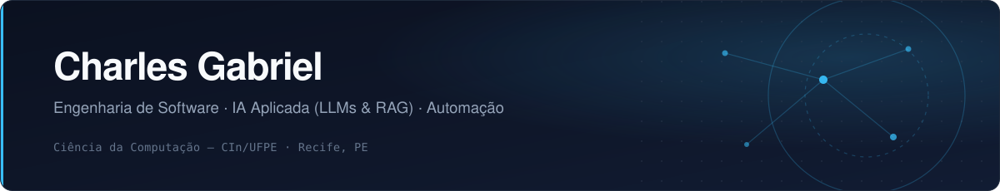

  

Desenvolvedor de software (**Ciência da Computação — CIn/UFPE**), com foco em **IA aplicada (LLMs/RAG)**, **backend** e **automação**.

## Projetos Principais

| Projeto | O que resolve | Stack |
| :--- | :--- | :--- |
| **[LLama-Rag-Reranker](https://github.com/charles-gabriel-cc/LLama-Rag-Reranker)** | Pipeline de RAG com reranking via LlamaIndex, roteamento inteligente com saída estruturada (Ollama + Instructor), memória conversacional em streaming e interface Gradio | `Python` `LlamaIndex` `Ollama` `Instructor` `Gradio` |
| **[TTS-app](https://github.com/charles-gabriel-cc/TTS-app)** | Assistente virtual por voz e texto (STT Whisper + Google TTS + RAG em Qdrant + orquestração n8n/Gemini) para o CCEN/UFPE, com app web/PWA e Android via Capacitor | `Python` `FastAPI` `Next.js` `Qdrant` `Whisper` `n8n` |
| **[create-plus-server](https://github.com/charles-gabriel-cc/create-plus-server)** | Gerenciamento híbrido de modpack NeoForge (Modrinth + Packwiz), gerador de 458 quests em Python e pipeline de deploy automático para EnxadaHost + AutoModpack | `Python` `Java` `Packwiz` `GitHub Actions` |

## Estudos & Fundamentos (CIn/UFPE)

| Repositório | Foco | Stack |
| :--- | :--- | :--- |
| **[Diagnostic-Analysis-for-Text-Classification](https://github.com/charles-gabriel-cc/Diagnostic-Analysis-for-Text-Classification)** | Estudo comparativo de técnicas de explicabilidade (Saliency, InputXGrad, Guided Backprop, Occlusion e LIME) em CNN/LSTM | `Python` `PyTorch` `NLTK` `Jupyter` |
| **[RPN-stacker](https://github.com/charles-gabriel-cc/RPN-stacker)** | Evolução de um avaliador de Notação Polonesa Reversa até um interpretador completo com Lexer, Parser, AST (Visitor) e Interpreter | `Java` |
| **[Concorrente](https://github.com/charles-gabriel-cc/Concorrente)** · **[Concurrency-vs-sequencial](https://github.com/charles-gabriel-cc/Concurrency-vs-sequencial)** | Problemas clássicos de sincronização (`sync.Mutex`, goroutines) e benchmark I/O-bound (`ThreadPoolExecutor`) | `Go` `Python` |
| **[Deferred-Shading](https://github.com/charles-gabriel-cc/Deferred-Shading)** · **[Curvas-de-b-zier](https://github.com/charles-gabriel-cc/Curvas-de-b-zier)** | Iluminação interativa com mapas difuso/normal/especular e editor interativo de curvas em Canvas | `Processing` `JavaScript` `HTML5 Canvas` |

## Stack Principal

| Área | Tecnologias |
| :--- | :--- |
| **Linguagens** |      |
| **IA & Dados** |        |
| **Backend & Infra** |      |
